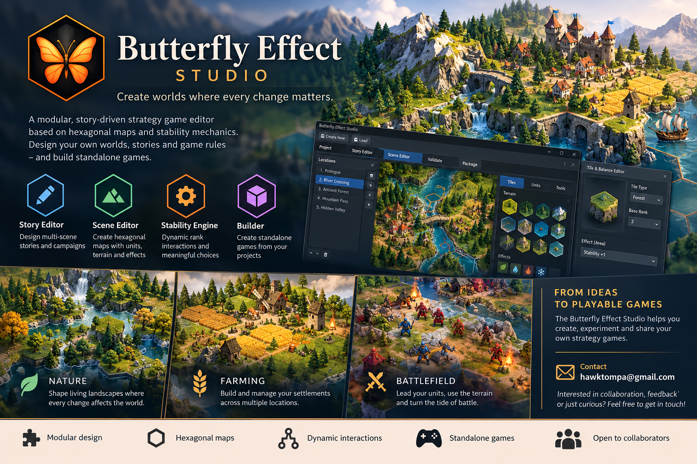
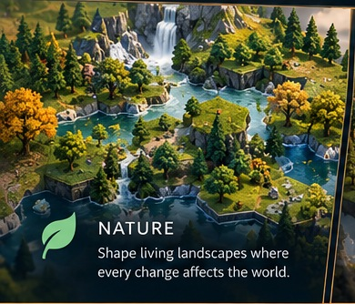
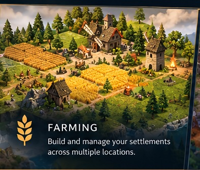
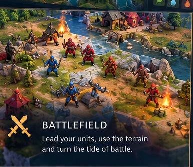

# 🦋 Butterfly Effect Studio

**Create worlds where every change matters.**

Butterfly Effect Studio is an evolving, modular authoring environment for hexagonal strategy games. It brings together story planning, scene editing, and a C++ stability engine that evaluates how tile ranks and interactions affect a map.

> **Development status:** Work in progress. The artwork above is an **original promotional concept illustration**, not a screenshot of the current application. It depicts planned features, including the graphical Tile & Balance Editor and standalone-game Builder, which are **not yet complete**.

## What we're building

| Story Editor | Scene Editor | Stability Engine | Builder |
| --- | --- | --- | --- |
| Arrange scenes and story metadata | Edit hex maps, terrain, units and tile definitions | Calculate rank interactions and test stability | Planned: package standalone playable games |

The current focus is **stabilizing project loading, scene editing, validation, and saving**. Next come a graphical balance editor, story runtime with persistent party/inventory, and a Builder for standalone games.

## Worlds we're exploring

These are **original concept illustrations**, not screenshots or artwork borrowed from existing games.

| Nature | Farming | Battlefield |
| --- | --- | --- |
|  |  |  |
| Landscapes and tile interactions | Resources and settlement growth | Units, factions and positional effects |

Other internal templates include Default, City Builder, and Warlord. These are development test cases, **not released standalone games**.

## Our roadmap

1. **Studio reliability:** project create/load, safe saves, scene switching, validation and regression tests.
2. **Editing tools:** visual tile properties, effects and balance feedback.
3. **Playable runtime:** scene progression, win conditions, party/army and inventory persistence.
4. **Standalone builds:** package playable games independently from the Studio.
5. **Showcase games:** publish a few finished games before considering a public Studio release.

## Get involved

We're happy to hear from people interested in:

- **Python / PySide6:** editor usability, tools and testing.
- **C++:** stability-engine integration, performance and tests.
- **Game design:** hex-based systems, progression and balance.
- **Original game art and UI/UX:** clear, consistent visuals.
- **Playtesting and feedback:** workflows, bugs and game mechanics.

You don't need to commit to a big role. Feedback, discussion and small contributions are welcome.

**Contact:** [hawktompa@gmail.com](mailto:hawktompa@gmail.com?subject=Butterfly%20Effect%20Studio%20-%20Collaboration)

## Repository scope and rights

This is a **public showcase and invitation to collaborate**, not the Studio source-code repository. It intentionally contains no engine source, game projects, secrets or proprietary assets.

All included illustrations were generated specifically for the Butterfly Effect Studio showcase. They are **concept art**, not third-party game title screens. Please contact the project maintainer before reusing the showcase's branding or images.

No software source-code license is granted by this repository. Any future public source-code release will specify its license separately.
